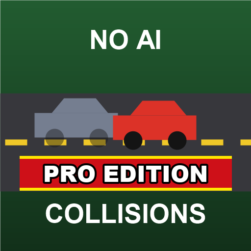

# ModHub upload: No AI Collisions Pro Edition

What to enter in the GIANTS ModHub upload form for this mod. Each text box below has a copy button on GitHub.



**Mod Icon (512x512):** [`icon_512.png`](icon_512.png)

| Field | Value |
|-------|-------|
| Title English | No AI Collisions Pro Edition |
| Title German | Keine KI-Kollisionen Pro Edition |
| Title French | Pas de collisions IA Pro Edition |
| Version | `1` `5` `0` `1` |
| Author | DTM Mods, PropaineX |
| Manufacturer | Lizard |
| Category 1 | Gameplay |
| Category 2 | Not Set |
| Category 3 | Not Set |

## Title English
```text
No AI Collisions Pro Edition
```

## Title German
```text
Keine KI-Kollisionen Pro Edition
```

## Title French
```text
Pas de collisions IA Pro Edition
```

## Description English
```text
Description: AI traffic cars that stand still become pass-through so you never get stuck behind them, and helpers drive through whatever blocks them after 2 seconds instead of waiting forever.
Hotkeys: none, no settings needed - just activate the mod.
GitHub: https://github.com/DTM-Mods/FS25_NoAICollisions_ProEdition

Never get stuck in AI traffic again!

- AI traffic behaves just like in the base game: it stops and waits for you, and moving cars are solid.
- Any traffic car that stands still near one of your vehicles for a couple of seconds becomes pass-through, so you can drive straight through it instead of getting jammed up.
- The car turns solid again once it drives off and is clear of your vehicles.
- Helpers (base game, AutoDrive and Courseplay) that are stopped by an obstruction for 2 seconds turn off collisions with it and continue on their course, driving forwards or reversing - whether it's an AI traffic car, a parked vehicle or your own vehicle.
- Two helpers that bump into each other or block each other drive through each other after 2 seconds, even when only one of them can see the other. A helper waiting its turn with a gap, like trucks queueing at an unload point, is never pushed into. A helper that faces the other one or crosses its path, like an unloader waiting in the field, is driven through.
- AutoDrive helpers going to the same destination wait in line for their turn and never drive into each other: the one further from the destination waits until the one ahead has moved on.
- A helper's load drives through along with it: pallets, bales and logs on a truck or trailer (strapped down, loaded by an autoloader or just standing in it) never push the other vehicle.
- Collisions are turned back on as soon as the helper has cleared the obstruction.
- Works for you and your helpers, in single player and multiplayer.
```

## Description German
```text
Beschreibung: Stillstehende KI-Verkehrsautos werden durchlässig, sodass du nie hinter ihnen feststeckst, und Helfer fahren nach 2 Sekunden durch das, was sie blockiert, statt ewig zu warten.
Tastenkombinationen: keine, keine Einstellungen nötig - einfach die Mod aktivieren.
GitHub: https://github.com/DTM-Mods/FS25_NoAICollisions_ProEdition

Nie wieder im KI-Verkehr steckenbleiben!

- Der KI-Verkehr verhält sich genau wie im Grundspiel: Er hält an und wartet auf dich, und fahrende Autos sind fest.
- Jedes Verkehrsauto, das ein paar Sekunden lang in der Nähe eines deiner Fahrzeuge stillsteht, wird durchlässig, sodass du einfach hindurchfahren kannst, statt festzustecken.
- Das Auto wird wieder fest, sobald es weiterfährt und von deinen Fahrzeugen weg ist.
- Helfer (Grundspiel, AutoDrive und Courseplay), die 2 Sekunden lang von einem Hindernis aufgehalten werden, schalten die Kollision damit ab und fahren ihren Kurs weiter, vorwärts oder rückwärts - egal ob es ein KI-Verkehrsauto, ein abgestelltes Fahrzeug oder dein eigenes Fahrzeug ist.
- Zwei Helfer, die zusammenstoßen oder sich gegenseitig blockieren, fahren nach 2 Sekunden durcheinander hindurch, auch wenn nur einer von beiden den anderen sehen kann. Ein Helfer, der mit Abstand wartet, bis er an der Reihe ist, wie LKW in der Schlange an einer Abladestelle, wird nie angefahren. Ein Helfer, der dem anderen zugewandt ist oder seinen Weg kreuzt, wie ein Überladewagen, der auf dem Feld wartet, wird durchfahren.
- AutoDrive-Helfer mit demselben Ziel warten in einer Reihe, bis sie an der Reihe sind, und fahren nie ineinander: Der weiter vom Ziel entfernte wartet, bis der vordere weitergefahren ist.
- Die Ladung eines Helfers fährt mit ihm hindurch: Paletten, Ballen und Stämme auf einem LKW oder Anhänger (festgezurrt, von einem Autoloader geladen oder einfach darauf stehend) schieben das andere Fahrzeug nie weg.
- Die Kollisionen werden wieder eingeschaltet, sobald der Helfer das Hindernis hinter sich gelassen hat.
- Funktioniert für dich und deine Helfer, im Einzelspieler und im Mehrspieler.
```

## Description French
```text
Description : les voitures de la circulation IA à l'arrêt deviennent traversables, vous ne restez donc jamais bloqué derrière elles, et les ouvriers traversent ce qui les bloque après 2 secondes au lieu d'attendre indéfiniment.
Raccourcis clavier : aucun, aucun réglage nécessaire - activez simplement le mod.
GitHub : https://github.com/DTM-Mods/FS25_NoAICollisions_ProEdition

Ne restez plus jamais bloqué dans la circulation IA !

- La circulation IA se comporte comme dans le jeu de base : elle s'arrête et vous attend, et les voitures en mouvement restent solides.
- Toute voiture de la circulation arrêtée quelques secondes près d'un de vos véhicules devient traversable : vous pouvez passer au travers au lieu de rester coincé.
- La voiture redevient solide dès qu'elle repart et s'est éloignée de vos véhicules.
- Les ouvriers (jeu de base, AutoDrive et Courseplay) arrêtés 2 secondes par un obstacle désactivent la collision avec lui et poursuivent leur trajet, en marche avant ou arrière, qu'il s'agisse d'une voiture de la circulation IA, d'un véhicule garé ou de votre propre véhicule.
- Deux ouvriers qui se heurtent ou se bloquent se traversent après 2 secondes, même si un seul des deux voit l'autre. Un ouvrier qui attend son tour avec un écart, comme des camions en file à un point de déchargement, n'est jamais percuté. Un ouvrier tourné vers l'autre ou qui croise sa route, comme un transbordeur qui attend dans le champ, est traversé.
- Les ouvriers AutoDrive qui vont à la même destination attendent leur tour en file et ne se percutent jamais : celui qui est le plus loin de la destination attend que celui de devant soit reparti.
- Le chargement d'un ouvrier passe avec lui : palettes, balles et grumes sur un camion ou une remorque (sanglées, chargées par un autochargeur ou simplement posées) ne poussent jamais l'autre véhicule.
- Les collisions sont réactivées dès que l'ouvrier a dépassé l'obstacle.
- Fonctionne pour vous et vos ouvriers, en solo et en multijoueur.
```

## Before uploading

- An older, separate mod "No AI Collisions" (`FS25_NoAICollisions`, version 1.1.0.1, also by PropaineX) exists with the same basic feature. ModHub rejects near-copies of existing mods: upload only one of the two, and if the old one is already on ModHub, update that one instead of adding this as a new mod (owner's decision).
- The mod itself is English only: modDesc has no German or French title or description (the old "No AI Collisions" had a German one, which the German texts here reuse). The texts here do not add translations to the mod.
