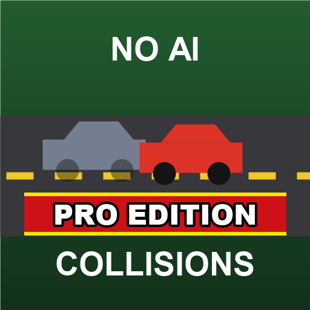

# ModHub upload: No AI Collisions Pro Edition

What to enter in the GIANTS ModHub upload form for this mod. Each text box below has a copy button on GitHub.



**Mod Icon (512x512):** [`icon_512.png`](icon_512.png)

| Field | Value |
|-------|-------|
| Title English | No AI Collisions Pro Edition |
| Title German | Keine KI-Kollisionen Pro Edition |
| Title French | Pas de collisions IA Pro Edition |
| Version | `1` `5` `0` `1` |
| Author | DTM Mods, PropaineX |
| Manufacturer | Lizard |
| Category 1 | Gameplay |
| Category 2 | Not Set |
| Category 3 | Not Set |

## Title English
```text
No AI Collisions Pro Edition
```

## Title German
```text
Keine KI-Kollisionen Pro Edition
```

## Title French
```text
Pas de collisions IA Pro Edition
```

## Description English
```text
Never get stuck in AI traffic again. AI traffic still behaves like in the base game: it stops and waits for you, and moving cars are solid. But a traffic car that stands still near one of your vehicles for a couple of seconds becomes pass-through, and your helpers drive on instead of waiting forever.

- A stopped traffic car near your vehicle becomes pass-through and turns solid again once it drives off and is clear of your vehicles.
- Helpers (base game, AutoDrive and Courseplay) stopped by an obstruction for 2 seconds drive through it, forwards or reversing: traffic cars, parked vehicles or your own vehicle.
- Two helpers that block each other drive through each other. A helper queueing with a gap, like trucks at an unload point, is never pushed into.
- AutoDrive helpers going to the same destination wait in line for their turn.
- A helper's load (pallets, bales, logs) drives through along with it.
- Collisions come back on as soon as the obstruction is cleared.
- Single player and multiplayer, no settings: just activate the mod.

Changelog 1.5.0.0:
- AutoDrive helpers that touch another vehicle, from any side, moving or stopped, pass through it until they are 2 m apart instead of getting stuck. Queues at the same AutoDrive point still wait in line.
- Any helper that touches a tree drives straight through it instead of stopping first.
```

## Description German
```text
Nie wieder im KI-Verkehr feststecken. Der KI-Verkehr verhält sich weiter wie im Grundspiel: Er hält für dich an, und fahrende Autos bleiben fest. Ein Verkehrsfahrzeug, das einige Sekunden neben einem deiner Fahrzeuge steht, wird aber durchfahrbar, und deine Helfer fahren weiter, statt ewig zu warten.

- Ein stehendes Verkehrsfahrzeug neben deinem Fahrzeug wird durchfahrbar und wieder fest, sobald es weiterfährt und deine Fahrzeuge frei sind.
- Helfer (Grundspiel, AutoDrive und Courseplay), die 2 Sekunden von einem Hindernis aufgehalten werden, fahren hindurch, vorwärts oder rückwärts: Verkehrsautos, geparkte Fahrzeuge oder dein eigenes Fahrzeug.
- Zwei Helfer, die sich gegenseitig blockieren, fahren durcheinander hindurch. Ein Helfer, der mit Abstand in einer Schlange wartet, etwa LKW an einer Abladestelle, wird nie angeschoben.
- AutoDrive-Helfer mit demselben Ziel warten in einer Reihe, bis sie dran sind.
- Die Ladung eines Helfers (Paletten, Ballen, Stämme) fährt mit ihm hindurch.
- Kollisionen sind wieder an, sobald das Hindernis frei ist.
- Einzel- und Mehrspieler, keine Einstellungen: einfach die Mod aktivieren.

Changelog 1.5.0.0:
- AutoDrive-Helfer, die ein anderes Fahrzeug berühren, ob von vorn, hinten oder der Seite, fahrend oder stehend, fahren hindurch, bis sie 2 m Abstand haben, statt festzustecken. Schlangen an derselben AutoDrive-Stelle warten weiter wie gewohnt.
- Jeder Helfer, der einen Baum berührt, fährt direkt hindurch, statt erst anzuhalten.
```

## Description French
```text
Ne restez plus jamais bloqué dans la circulation IA. La circulation IA se comporte toujours comme dans le jeu de base : elle s'arrête et vous attend, et les voitures en mouvement restent solides. Mais une voiture arrêtée quelques secondes près d'un de vos véhicules devient traversable, et vos ouvriers repartent au lieu d'attendre indéfiniment.

- Une voiture arrêtée près de votre véhicule devient traversable, puis redevient solide une fois repartie et éloignée de vos véhicules.
- Les ouvriers (jeu de base, AutoDrive et Courseplay) bloqués 2 secondes par un obstacle le traversent, en marche avant ou arrière : voitures de la circulation, véhicules garés ou votre propre véhicule.
- Deux ouvriers qui se bloquent se traversent. Un ouvrier qui attend son tour avec un écart, comme des camions à un point de déchargement, n'est jamais percuté.
- Les ouvriers AutoDrive allant à la même destination attendent leur tour en file.
- Le chargement d'un ouvrier (palettes, balles, grumes) passe avec lui.
- Les collisions reviennent dès que l'obstacle est dégagé.
- Solo et multijoueur, aucun réglage : activez simplement le mod.

Changelog 1.5.0.0 :
- Les ouvriers AutoDrive qui touchent un autre véhicule, de n'importe quel côté, en mouvement ou à l'arrêt, le traversent jusqu'à être à 2 m au lieu de rester bloqués. Les files au même point AutoDrive attendent toujours leur tour.
- Tout ouvrier qui touche un arbre le traverse directement au lieu de s'arrêter d'abord.
```

## Before uploading

- An older, separate mod "No AI Collisions" (`FS25_NoAICollisions`, version 1.1.0.1, also by PropaineX) exists with the same basic feature. ModHub rejects near-copies of existing mods: upload only one of the two, and if the old one is already on ModHub, update that one instead of adding this as a new mod (owner's decision).
- The mod itself is English only: modDesc has no German or French title or description (the old "No AI Collisions" had a German one, which the German texts here reuse). The texts here do not add translations to the mod.
